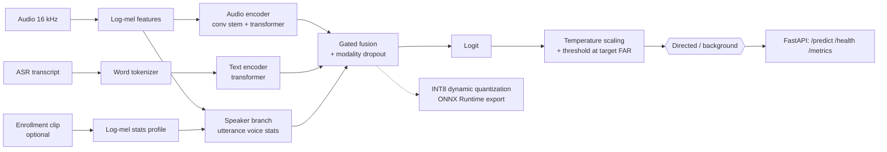
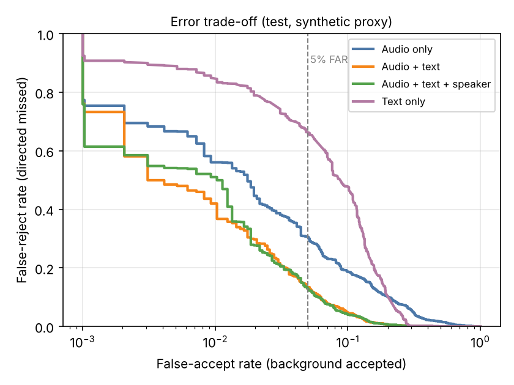
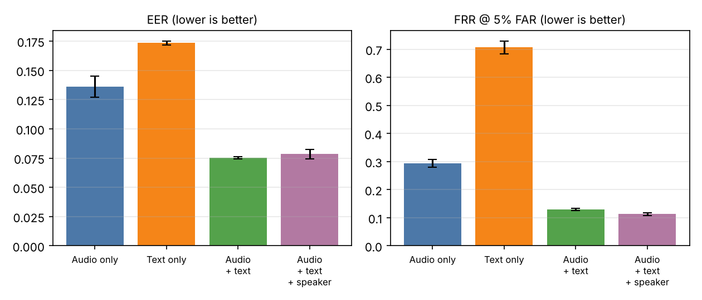
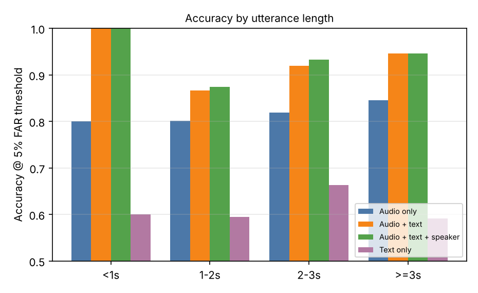
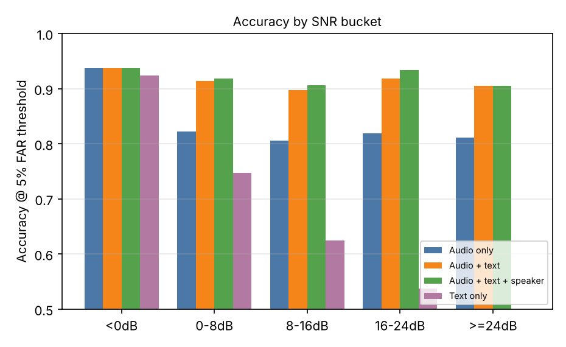
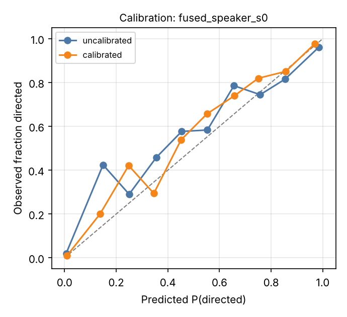
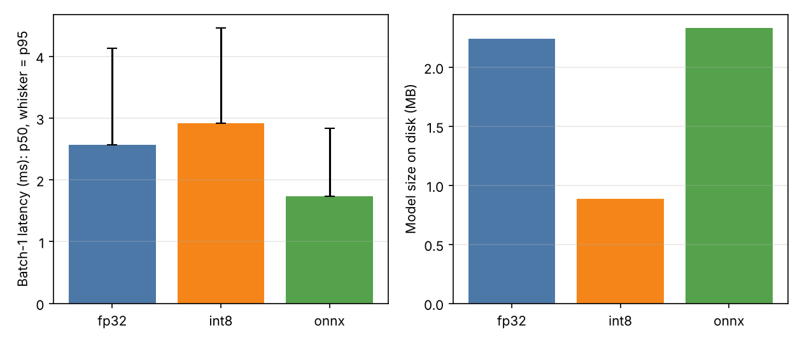

# Directed Speech Detector

A multimodal system that decides whether an utterance is **directed at a voice assistant** or is **background speech**, using the audio, the ASR transcript and an optional **enrolled-speaker** signal, with an eye on **on-device** deployment (INT8 quantization, ONNX export, latency/size benchmarks, a small FastAPI service).

> **Read this first: data and model path.** The build sandbox could reach PyPI but **not** Hugging Face or any dataset host, and had no GPU. So this repository uses the **from-scratch path**: compact encoders (log-mel transformer + word-level transformer) trained on a **synthetic proxy dataset** generated by `src/directed_speech_detector/data/synthetic.py`. **All numbers below are on that synthetic data. It is not real speech and not real assistant traffic**, and the results do not predict real-world accuracy. A Colab notebook and configs for a full-scale GPU run and a real-audio manifest path are included but **have not been run** (see [Limitations](#limitations) and `docs/EXPERIMENTS.md`).

## Why this matters for voice assistants
- A **false accept** (background speech treated as a request) can trigger actions, leak private conversation to the cloud, or interrupt people. A **false reject** makes the assistant feel unresponsive. Product teams therefore pick an operating point at a target false-accept rate, which is exactly how this project reports results.
- Evidence is multimodal: *how* something is said (proximity, prosody, noise), *what* is said (command-like text, wake word) and *who* said it (the enrolled user). No single cue is sufficient, and the ablations below quantify each one.
- Decisions must be fast and private, so the model is small (0.55 M parameters, 2.2 MB FP32 / 0.9 MB INT8) and exported to ONNX.

## Architecture


| Package | Contents |
|---|---|
| `data/` | synthetic generator, cached feature datasets, tokenizer, real-audio CSV manifest loader |
| `features.py` | log-mel extractor, speaker-profile statistics |
| `models/` | audio, text, speaker branches, gated fusion, top-level detector |
| `training/` | trainer (AdamW, warmup + cosine, early stopping), checkpoints |
| `evaluation/` | metrics (EER, FAR/FRR, ECE, temperature), per-condition analysis, plots, reports |
| `export.py`, `benchmark.py` | INT8, ONNX + parity test, FP32/INT8/ONNX benchmark |
| `serving/` | FastAPI app, validation schemas, Prometheus-format metrics, inference wrapper |

## Quickstart
Requires Python ≥ 3.10 and PyTorch (`pip install torch`; CPU is fine).
```bash
pip install -e ".[all]"                              # package + serving, export, plotting, dev tools
dsd train --config configs/fused_speaker.yaml        # generates synthetic data, trains, evaluates -> runs/fused_speaker
dsd serve --run-dir runs/fused_speaker --backend fp32 # API on http://127.0.0.1:8000 (docs at /docs)
```
Then, from another shell, `curl localhost:8000/health`. Other commands: `make test lint typecheck`, `dsd ablate --seeds 0 1 2 && dsd report`, `dsd export --run-dir ...`, `dsd benchmark --run-dir ...`. A Docker image is defined (`Dockerfile`, `docker-compose.yml`) but **was not built here** (no Docker daemon in the sandbox).

Example request (`audio_base64` is little-endian 16 kHz mono PCM16; `serving/schemas.py::encode_audio` builds it):
```json
POST /predict
{"audio_base64": "...", "transcript": "turn off the kitchen lights", "enrollment_audio_base64": "... (optional)"}
→ {"probability_directed": 0.448, "is_directed": false, "threshold": 0.666, "backend": "onnx", "enrollment_used": true,
   "latency": {"feature_ms": 2.52, "model_ms": 1.68, "total_ms": 4.91}}
```
(Response from the live smoke check in `docs/EXPERIMENTS.md` E4, ONNX backend, one synthetic utterance.)

## Results (synthetic proxy data)
Test split: 2,000 synthetic utterances from 80 households not seen in training. Mean ± std over 3 training seeds (data fixed; std is training-seed variance only). Operating point: threshold chosen on the validation split for 5% false-accept rate (FAR). Full per-run details: `docs/EXPERIMENTS.md`.

| Model | Params | Accuracy % | F1 % | Recall % | FRR % @5% FAR | EER % | AUC | ECE % |
|---|---:|---:|---:|---:|---:|---:|---:|---:|
| Audio only | 308,930 | 82.5 ± 0.6 | 80.5 ± 0.8 | 70.6 ± 1.4 | 29.4 ± 1.4 | 13.6 ± 0.9 | 0.940 ± 0.003 | 5.6 ± 2.0 |
| Text only | 189,794 | 61.8 ± 0.8 | 44.0 ± 2.4 | 29.3 ± 2.3 | 70.7 ± 2.3 | 17.3 ± 0.2 | 0.904 ± 0.001 | 4.0 ± 0.4 |
| Audio + text | 498,435 | 90.8 ± 0.1 | 90.7 ± 0.1 | 87.0 ± 0.4 | 13.0 ± 0.4 | 7.5 ± 0.1 | 0.978 ± 0.001 | 4.8 ± 2.3 |
| Audio + text + speaker | 552,771 | 91.4 ± 0.4 | 91.4 ± 0.4 | 88.7 ± 0.5 | 11.3 ± 0.5 | 7.8 ± 0.4 | 0.978 ± 0.001 | 2.1 ± 0.4 |

Realised test FAR at the validation-derived 5% threshold is 4.9 / 3.8 / 5.2 / 5.8 % (audio / text / audio+text / +speaker): thresholds transfer approximately, not exactly, from a 1,000-utterance validation set.




### Ablation findings
1. **Fusion is the big win.** Audio + text cuts EER by 45 % relative to audio alone (13.6 → 7.5 %) and cuts FRR at 5% FAR from 29.4 % to 13.0 %. The proxy was built so that neither channel alone is sufficient, so this confirms the pipeline exploits complementary evidence rather than showing anything about real speech.
2. **Text alone is weak at a strict operating point** (FRR 70.7 % at 5% FAR) because identical sentences occur in both classes by design, even though its AUC (0.904) looks respectable. AUC alone would hide this.
3. **The speaker branch helps modestly and inconsistently.** FRR @5% FAR improves 13.0 → 11.3 % and accuracy 90.8 → 91.4 %, but EER does not improve (7.5 vs 7.8 %, within about one std) and withholding the enrollment profile at inference barely matters (EER 8.0 ± 0.5 %, FRR 11.6 ± 1.2 %). The branch therefore mostly adds voice-statistics context rather than a strong enrolled-vs-other comparison; a real speaker embedding (see roadmap) is the obvious next step. With 3 seeds, treat the small differences as suggestive, not established.
4. **Calibration:** temperature scaling lowered ECE for the speaker model (3.4 → 2.1 %) but not consistently: audio-only improved slightly (6.1 → 5.6 %), audio + text was unchanged (4.8 → 4.8 %) and text-only got worse (3.5 → 4.0 %), so I do not claim a general calibration gain.

### Per-condition error analysis (seed 0, audio + text + speaker, 5% FAR threshold)
Full tables and confusion examples: `docs/results/error_analysis.md`. Single-model, single-seed, small buckets: indicative only.
- **Utterance length:** accuracy 87.4 % for 1–2 s (n=594) vs 93.3 % for 2–3 s (n=1,031) and 94.6 % for ≥ 3 s (n=370). Short utterances are hardest; FRR 17.0 % vs 4.1 %.
- **SNR:** accuracy stays within 90.6–93.7 % across buckets (no monotone trend; 0–8 dB FRR 20.3 % vs 16–24 dB 6.2 %).
- **Reverberation (a shortcut I built into the generator):** utterances with RT60 ≥ 0.5 s are rejected far more (FRR 50.0 %, n=451) than RT60 < 0.25 s (FRR 3.6 %, but FAR 20.9 %, n=573). The model learned "echoey ⇒ background", a proxy for distance that real data would only partly share.
- **Speaker:** accuracy 90.3 % for the enrolled user vs 94.6 % for other speakers: the enrolled user speaks background lines 35 % of the time, which is where the model errs.





## Latency / size trade-offs (audio + text + speaker, seed 0)
One intra-op thread, Intel Xeon @ 2.1 GHz (sandbox VM), 300 timed batch-1 calls, model forward only (log-mel for 2.5 s of audio adds 0.57 ms p50). Accuracy/FRR/FAR use the FP32 model's calibrated threshold for every backend. **CPU server numbers, not phone/NPU numbers.**

| Backend | Size MB | p50 ms | p95 ms | Throughput utt/s (batch 32) | Accuracy % | FRR % | FAR % | EER % |
|---|---:|---:|---:|---:|---:|---:|---:|---:|
| FP32 (PyTorch) | 2.24 | 2.57 | 4.13 | 742 | 91.80 | 10.59 | 5.66 | 7.31 |
| INT8 (dynamic) | 0.88 | 2.92 | 4.46 | 868 | 91.80 | 10.50 | 5.77 | 7.31 |
| ONNX Runtime | 2.33 | 1.74 | 2.83 | 473 | 91.80 | 10.59 | 5.66 | 7.31 |

- **INT8** is 2.5× smaller with the same accuracy on this test set, but at batch 1 it was *slower* than FP32 (p50 2.92 vs 2.57 ms): dynamic quantization only covers the linear layers, and the conv/attention/layer-norm work stays FP32 with added quantize/dequantize overhead. Its batch-32 throughput was higher (868 vs 742 utt/s).
- **ONNX Runtime** had the lowest batch-1 latency (1.48× lower p50 than FP32) with numerically identical decisions (max |Δlogit| = 3.8e-6 in the parity test) but the lowest batch-32 throughput in this single-thread setup.
- Single benchmark run; small gaps are within plausible noise. Core ML and on-device (ANE/NPU) measurements are not yet run.



## Reproducibility
Config-driven (`configs/*.yaml`, `--set section.key=value` overrides), seeded generator and training, deterministic splits independent of worker count, a test asserting identical loss curves for repeated training under identical settings. Bit-exactness does **not** hold across thread counts: re-running seed 0 with 4 threads instead of 1 gave a test EER of 7.8 % vs 7.3 % (see `docs/EXPERIMENTS.md` E6), comparable to the seed-to-seed spread. Exact commands/configs/hardware for every reported number: `docs/EXPERIMENTS.md`. Design choices: `docs/DECISIONS.md`. Data caveats: `docs/DATA.md`. Model card: `docs/MODEL_CARD.md`.

## Quality
`pytest` (67 tests, 97 % line coverage of `src/`, incl. ONNX parity, padding-invariance, API validation, end-to-end train→evaluate→export→serve), `ruff` lint + format, `mypy --strict`, pre-commit hooks, GitHub Actions workflow (lint, type-check, tests on Python 3.11/3.12), Makefile targets (`setup test lint train eval export serve`). Verified locally on Python 3.13.

## Limitations
- **Synthetic proxy data only.** Acoustic and text differences between classes are my assumptions; the speaker voices are random draws. Results say nothing about real devices.
- Class prior is 50/50 here; real directed-speech prevalence is lower, so precision will be lower at the same FAR/FRR.
- Models are tiny and trained from scratch; no pretrained speech/text encoders, no real ASR, no dialogue context, no multilingual support.
- The speaker branch uses pooled log-mel statistics rather than a trained speaker embedding.
- 3 seeds with fixed data: no confidence intervals over data resampling.
- Only CPU-server latency was measured; no mobile/NPU measurement, no Core ML export. Dockerfile and compose file are untested beyond `docker compose config`.
- Full-scale GPU run (`notebooks/colab_full_training.ipynb`, `configs/colab_full.yaml`) and real-audio manifest run: **not yet run**.

## Roadmap
1. Run the Colab full-scale study and record results in `docs/EXPERIMENTS.md`.
2. Real-audio evaluation via the manifest path (SLURP / Fluent Speech Commands vs LibriSpeech / AMI) and a discussion of the dataset-identity confound.
3. Fine-tune pretrained audio (wav2vec2/HuBERT-class) and text (DistilBERT-class) encoders; compare with from-scratch.
4. Replace the statistics-based speaker branch with a trained speaker-verification embedding; evaluate unseen-speaker generalisation.
5. Core ML export and on-device latency/energy measurements; static INT8 / QAT for conv layers.
6. Add dialogue/context features and streaming (frame-synchronous) inference.

## License
MIT, see `LICENSE`.
